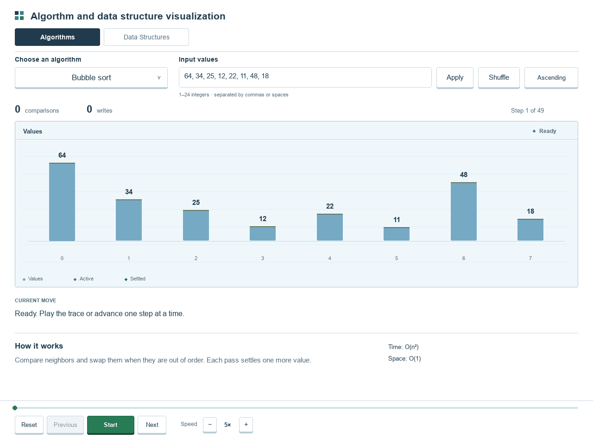
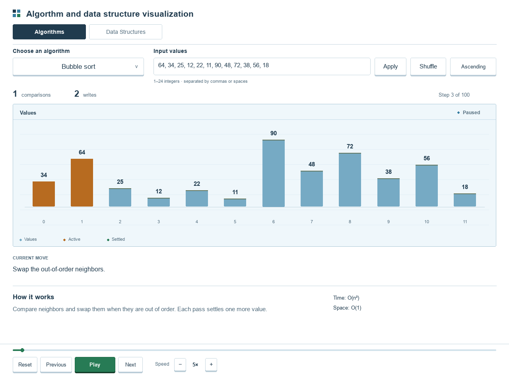
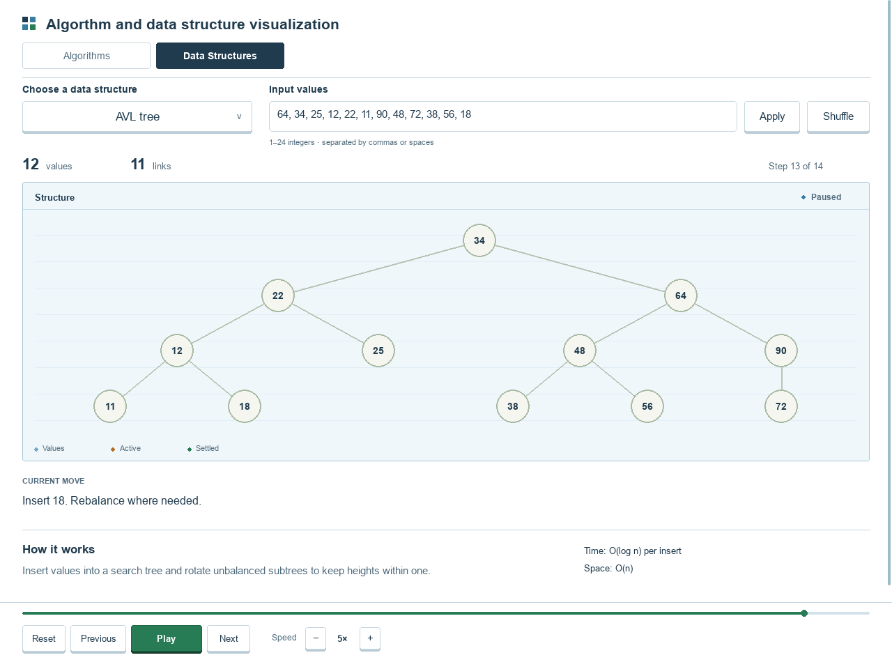

# Algorthm and data structure visualization

An interactive Python desktop app for learning algorithms and data structures. Choose a topic, enter your values, and follow the visualization one step at a time.

The interface has two main sections: **Algorithms** and **Data Structures**.

## Demo

The GIF shows Bubble sort running to completion, then switches to Data Structures to build a stack and pop its top value.



## Getting started

Requires **Python 3.10 or later**. On Windows, use a standard installation from [python.org](https://www.python.org/downloads/).

### Windows / PowerShell

```powershell
python -m venv .venv
.\.venv\Scripts\python.exe -m pip install -r requirements.txt
.\run.cmd
```

If the project environment is already installed, just run:

```powershell
.\run.cmd
```

You can also double-click `run.cmd`, or launch directly:

```powershell
.\.venv\Scripts\python.exe main.py
```

### macOS / Linux

```sh
python3 -m venv .venv
.venv/bin/python -m pip install -r requirements.txt
.venv/bin/python main.py
```

The application uses **pygame-ce**, which provides the `pygame` module. Install it using `requirements.txt` in a virtual environment.

## Screenshots

### Algorithms

Custom input, comparison and write counters, highlighted values, and playback controls.



### Data Structures

The same controls work with lists, stacks, queues, trees, heaps, and hash tables.



## Available topics

| Main section | Topics |
| --- | --- |
| Algorithms — sorting | Bubble, insertion, selection, merge, quick, heap, and shell sort |
| Algorithms — searching | Linear and binary search |
| Algorithms — graphs | Breadth-first search, depth-first search, Dijkstra, Prim, and Kruskal |
| Algorithms — compression | Huffman coding |
| Data Structures | Singly linked list, doubly linked list, stack, queue, binary search tree, AVL tree, min heap, max heap, and hash table |

There are **24 visualizations** in total. Algorithm groups appear inside the topic dropdown; the main navigation stays at two tabs.

## How to use it

1. Choose **Algorithms** or **Data Structures**.
2. Pick a topic from the dropdown.
3. Edit the input values and select **Apply**. Use **Shuffle** for another sample.
4. Select **Start**, then pause, move backward or forward, or drag the timeline to inspect a step.

Sorting supports ascending and descending order. Speed ranges from 1× to 10×. After a stack or queue is built, use **Pop** or **Dequeue** to remove a value. Backward playback lets you revisit earlier states.

The app detects the monitor size when it opens. Resizing redraws the interface at the window's actual resolution: controls wrap, content scrolls, and playback stays at the bottom. Wide visualizations have a horizontal scrollbar. Sorting and searching follow active values automatically.

### Input and visualization details

- Enter **1–24 integers**, separated by commas or spaces, from **-9999 to 9999**.
- Huffman coding requires positive integers and treats them as symbol frequencies.
- Binary search sorts the input first and reports an index in that sorted array.
- Graph algorithms use a fixed, weighted, undirected sample graph with source **A**.
- Array indexes start at **0**. A swap counts as two array writes.
- Complexity descriptions refer to the underlying algorithms; the app also stores snapshots for backward playback.

### Keyboard and mouse controls

| Control | Action |
| --- | --- |
| Space | Play / pause |
| Left / right arrow | Previous / next step |
| R | Reset playback |
| Tab | Focus the input field and scroll it into view |
| Enter | Apply input changes |
| Escape | Leave the input field or close the dropdown |
| Ctrl+A / Ctrl+V | Select all / paste in a focused input field |
| F11 | Toggle fullscreen and restore the previous window size |
| Mouse wheel / Page Up / Page Down | Scroll the content |
| Home / End | Scroll to the beginning / end |
| Shift + mouse wheel | Pan a wide visualization horizontally |
| Drag the timeline | Jump to another step |

## Troubleshooting

**`ModuleNotFoundError: No module named 'pygame'`**

Use the project's Python environment:

```powershell
.\.venv\Scripts\python.exe -m pip install -r requirements.txt
.\.venv\Scripts\python.exe main.py
```

**`pip` is not recognized**

Run pip through Python. The `-r` option tells pip to read a requirements file:

```powershell
python -m pip install -r requirements.txt
```

If you see `No module named pip`, install a standard Python distribution and recreate the virtual environment using that interpreter.

## Development

Run the algorithm and headless interface tests:

```powershell
.\.venv\Scripts\python.exe -m unittest discover -s tests -v
```

Render a screenshot without opening a window:

```powershell
.\.venv\Scripts\python.exe main.py --size 1280x800 --screenshot preview.png
```

Recreate the README screenshots and GIF with the optional **Pillow** dependency:

```powershell
.\.venv\Scripts\python.exe -m pip install Pillow
.\.venv\Scripts\python.exe scripts/capture_readme.py
```

The capture script renders the actual application and its algorithm traces. Generated README media is stored in `docs/images/`.

```text
main.py                    Application entry point
run.cmd                    Windows launcher
requirements.txt           Application dependency
studio/algorithms.py       Algorithm traces and explanations
studio/app.py              Window, input, and playback behavior
studio/view.py             Responsive interface and topic selection
scripts/capture_readme.py   README screenshots and GIF generation
tests/                     Algorithm and interface tests
docs/images/               README media
```

The original standalone sorting demos are preserved in `Data structure and algorithm/`. Use `main.py` for the unified application.

## License

[MIT](LICENSE)
